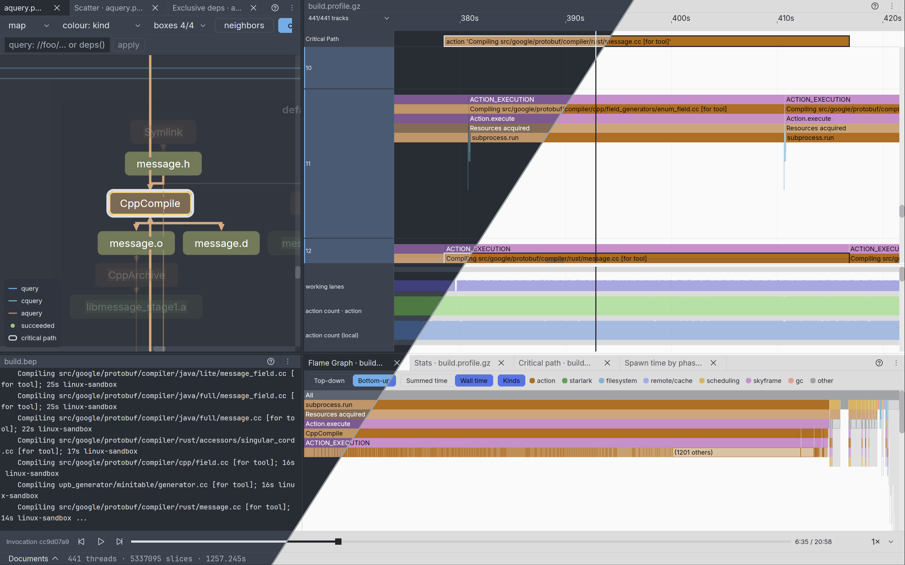

# bviz

A graphical Bazel build visualization and inspection tool.



Seeing what a Bazel build actually did is hard. bviz reads the outputs Bazel
generates, such as query results, the trace profile and the build event log,
and lets you explore them visually.

bviz is early in development. Expect rough edges, and expect the interface and
command line to change.

## Features

### Build graph

The target and action graph from `query`, `cquery` and `aquery` output, merged
into one graph to expand, search and filter.

### Trace profile

The timeline of a build's trace profile: what ran when, and flame graphs of
where the time went, weighed by summed time or by share of the wall time.

### Build event protocol

The console output of a build, replayed from its build event log.

bviz can open several files at once.

## Install

Download the latest build of `main` for arm64 or x86_64 Linux or macOS from the
[nightly release](../../releases/tag/nightly).

| | Linux | macOS |
| --- | --- | --- |
| Architecture | arm64, x86_64 | arm64, x86_64 |
| Operating system | glibc 2.28 or newer | macOS 14 or newer |
| Display | a Wayland session | |
| Graphics | a Vulkan driver | Metal |

On an X11 session, run bviz inside a nested Wayland compositor such as
[cage](https://github.com/cage-kiosk/cage): `cage -- bviz --profile build.profile.gz`.

The arm64 Linux and the macOS binaries are cross-compiled on x86_64 Linux and are
not tested in CI. The macOS binaries are not signed, and macOS blocks an unsigned
download until you clear its quarantine flag:
`xattr -d com.apple.quarantine bviz`.

To build from source, see [CONTRIBUTING.md](CONTRIBUTING.md).

## Quick start

In a Bazel workspace, profile a build and open the profile:

```sh
bazel build --profile=/tmp/build.profile.gz //...
bviz --profile /tmp/build.profile.gz
```

## Usage

bviz opens every file named on its command line, and needs at least one.

### Dependency graph

```sh
bazel query --output=streamed_proto --consistent_labels --noproto:flatten_selects //... > /tmp/query.pb
bazel cquery --output=streamed_proto --consistent_labels --transitions=lite //... > /tmp/cquery.pb
bazel aquery --output=streamed_proto //... > /tmp/aquery.pb
bviz --query /tmp/query.pb --cquery /tmp/cquery.pb --aquery /tmp/aquery.pb
```

Any one of the three is enough. bviz merges them into a single graph, so each
flag takes one file. bviz reads the most from files written with these flags,
some of which Bazel sets by default:

- query: `--consistent_labels`, `--proto:output_rule_attrs` (default `all`),
  which tells implicit dependencies from explicit ones,
  `--proto:default_values` (default on), which states the package default
  visibility a query's dependencies follow, and `--noproto:flatten_selects`,
  without which a `select` is written merged into one value, so `attr()`
  cannot match its branches as Bazel does and its conditions read as
  implicit dependencies
- cquery: `--consistent_labels`, `--transitions=lite` (or `full`), which
  tells tool dependencies apart, and `--proto:output_rule_attrs` (default
  `all`)
- aquery: `--include_artifacts` (default on)

`visible()` reads the package groups each visibility names, which a query of
`//...` leaves out, it naming rules alone; query `//...:*`, or `deps()` over
the targets, to hold them.

### Trace profile

```sh
bazel build --profile=/tmp/build.profile.gz //...
bviz --profile /tmp/build.profile.gz
```

For a more complete profile, add `--noslim_profile --record_full_profiler_data
--experimental_profile_include_target_label
--experimental_profile_include_target_configuration
--experimental_profile_include_primary_output`. The profile then keeps short
events and names each action's target and primary output, at the cost of a
larger file.

### Console replay

```sh
bazel build --show_timestamps --build_event_binary_file=/tmp/build.bep //...
bviz --bep /tmp/build.bep
```

Bazel does not timestamp its progress output, so without `--show_timestamps` the
replay interpolates its timing between the events that do carry a clock.

`--profile` and `--bep` can be repeated, and combined with the graph flags, to
open several files grouped by Bazel invocation.

## Getting help

Report bugs and ask questions in the [issue tracker](../../issues).

## Contributing

See [CONTRIBUTING.md](CONTRIBUTING.md).

## Acknowledgements

bviz draws with [gpui](https://github.com/zed-industries/zed), the UI framework
of the Zed editor, and lays out graphs with
[elk-rs](https://github.com/openedges/elk-rs), a Rust port of the Eclipse
Layout Kernel.

## License

bviz is licensed under the Apache License 2.0; see [LICENSE](LICENSE). The
third-party works it bundles or derives from, and their terms, are listed in
[NOTICE](NOTICE).
